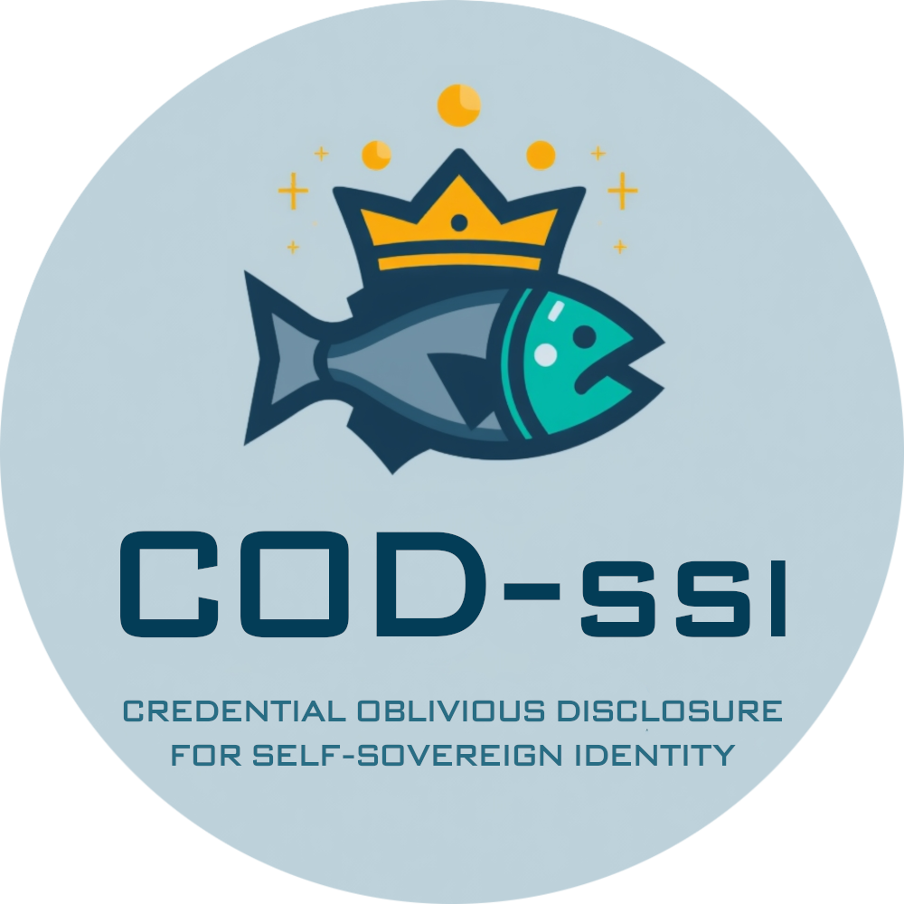
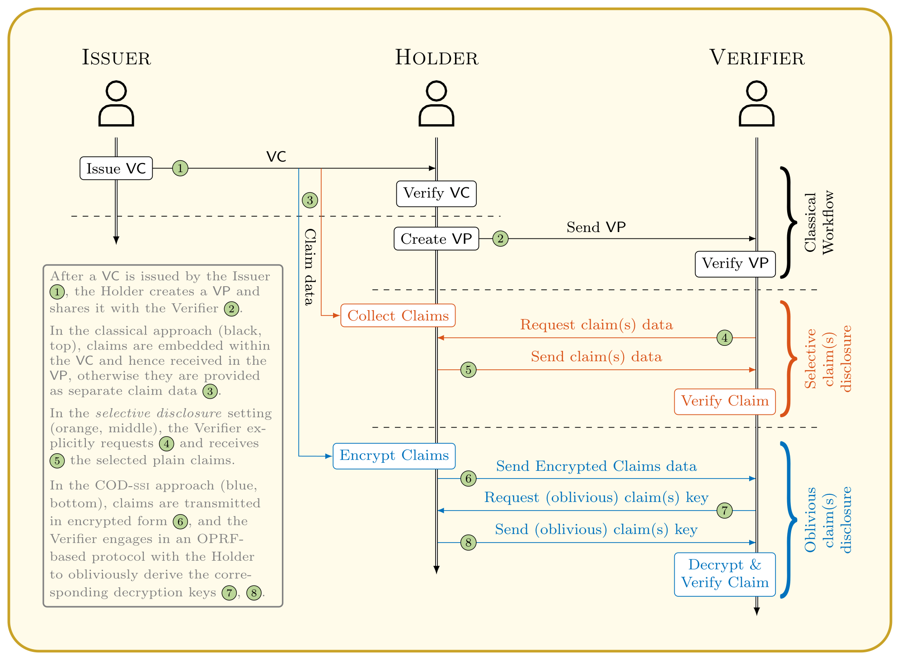
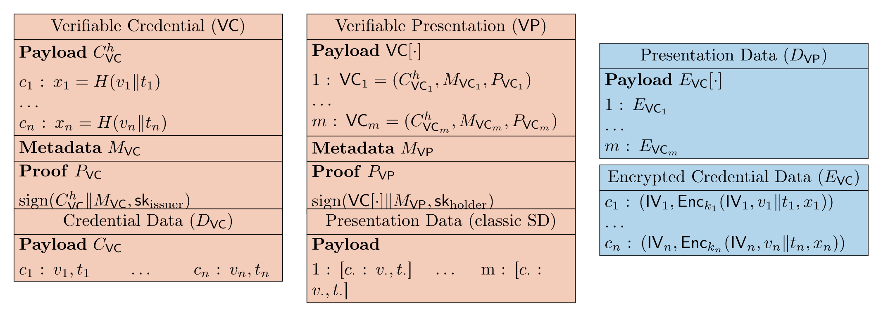

<p align="center">
  
</p>

# COD-SSI: Enforcing Mutual Privacy for Credential Oblivious Disclosure in Self Sovereign Identity

[](https://doi.org/10.1007/978-3-032-38695-3_11)
[](https://esorics2026.org)
[](LICENSE)

This is the companion repository for the paper:

> **COD-SSI: Enforcing Mutual Privacy for Credential Oblivious Disclosure in Self Sovereign Identity**  
> by _Elia Onofri, Andrea De Salve, Paolo Mori, Laura Emilia Maria Ricci, and Roberto Di Pietro_.  
> ESORICS 2026 (to appear).  
> An extended version is available as [arXiv:2604.10685](https://doi.org/10.48550/arXiv.2604.10685).

It contains the proof-of-concept implementation, the benchmark data, and the analysis notebook needed to reproduce the experimental evaluation of the paper.


## Overview

Self-Sovereign Identity (SSI) is a decentralised identity paradigm in which users issue, hold, and present their own Verifiable Credentials without relying on a central authority.
Selective Disclosure (SD) — revealing only a chosen subset of the claims inside a credential — is one of its most attractive privacy features, yet existing mechanisms protect only the Holder: the *specific* claims a Verifier asks for can themselves leak the Verifier's internal decision criteria, business rules, or strategic intent.

**COD-SSI** (Credential Oblivious Disclosure for SSI) closes this gap and provides, to the best of our knowledge, the first approach enforcing *mutual* privacy in credential exchange.
The Holder offers a set of `N` disclosable claims; the Verifier obliviously retrieves at most `N_o < N` of them, learning nothing about the unrequested claims, whilst the Holder learns nothing about which claims were selected.
The construction leverages an Oblivious Pseudorandom Function (the discrete-log 2HashDH instantiation over `secp256k1`) to derive a per-claim symmetric key that the Verifier can recover only through an interactive, oblivious protocol with the Holder.
Each claim is then sealed under AES-256-GCM, so undisclosed claims remain indistinguishable from random ciphertexts.

The security of the scheme is formally analysed in the paper, and its feasibility is assessed through the prototype released here, showing that provable mutual privacy can be achieved with only moderate computational and communication overhead.




### About the name

**COD-SSI** stands for *Credential Oblivious Disclosure for Self-Sovereign Identity*.
The qualifier *oblivious* is the crux of the contribution: disclosure happens, the bound `N_o` is enforced, and integrity is verified — yet the selection itself stays hidden from the counterparty, in the spirit of oblivious transfer.


## Table of Contents

1. [Overview](#overview)
2. [Key results](#key-results)
3. [Repository layout](#repository-layout)
4. [The protocol in one figure](#the-protocol-in-one-figure)
5. [Installation](#installation)
6. [Running the proof of concept](#running-the-proof-of-concept)
7. [Configuration](#configuration)
8. [Performance data](#performance-data)
9. [Reproducing the figures](#reproducing-the-figures)
10. [License](#license)
11. [Citation](#citation)
12. [Acknowledgments](#acknowledgments)
13. [Contact / Issues](#contact--issues)


## Key results

A few headline figures from the experimental evaluation (Section 5 of the paper; full plots in `analysis/imgs/`).

Per-claim operations are independent of the credential size; their average costs are:

| Operation         | Party    | Average time |
|-------------------|----------|--------------|
| Claim hashing     | Issuer   | < 0.02 ms    |
| Claim encryption  | Holder   | ≈ 7.6 ms     |
| Claim decryption  | Verifier | ≈ 6.3 ms     |
| OPRF request      | Verifier | ≈ 7.5 ms     |
| OPRF response     | Holder   | ≈ 6.1 ms     |

Aggregate cost and size scale linearly in the number of claims:

| Quantity                              | 2 claims | 1024 claims |
|---------------------------------------|----------|-------------|
| Verifiable Presentation size          | 3 kB     | 0.53 MB     |
| Encrypted data `D_VP` size            | 6 kB     | 2.5 MB      |
| `D_VP` encryption / decryption time   | ≈ 10 ms  | ≈ 10 s      |
| OPRF request / response size          | —        | ≈ 0.12 MB   |

In practice, disclosing the claims of a presentation with up to 128 claims takes from a few milliseconds to under two seconds, with storage between a few kilobytes and roughly 1 MB — overheads that do not materially affect the user experience in typical SSI scenarios.


## Repository layout

```
.
├── README.md                       # this file
├── CHANGELOG.md                    # release history
├── LICENSE                         # CC BY-NC-SA 4.0
├── logo.png                        # project logo
├── sequenceDiagram.png             # end-to-end flow (paper Figure 1)
├── VP_structure.png                # VP / encrypted-data structure (paper Figure 2)
├── src/                            # JavaScript proof of concept
│   ├── demo.js                     # self-contained, runnable COD-SSI demo
│   ├── main.js                     # benchmarking harness (needs the did:ethr stack)
│   ├── config.json                 # protocol and experiment parameters
│   ├── package.json
│   └── OPRF/
│       ├── main.js                 # reference implementation of the protocol
│       └── hashAttributes.js       # hash-based claim commitments (HMAC-SHA3-512)
├── performancesData/               # benchmark data backing the paper's figures
│   ├── COD-ssi.json                # COD-SSI timings (reduced subset, see below)
│   └── hash-SD.json                # classical hash-based SD baseline
└── analysis/
    ├── PerformanceAnalysis.ipynb   # figure-generation notebook
    ├── requirements.txt            # pinned Python environment
    └── imgs/                       # figures regenerated by the notebook
```


## The protocol in one figure

The structure of a Verifiable Presentation under COD-SSI is shown below (paper Figure 2).
The red boxes are the standard hash-based SD material; the blue boxes are the additional encrypted payload `D_VP` that COD-SSI introduces, holding, for each claim, the AES-GCM ciphertext, its nonce, and its authentication tag.




## Installation

The repository has two independent components: the JavaScript proof of concept under `src/`, and the Python analysis under `analysis/`.

### Proof of concept (Node.js)

The demo targets Node.js 18 or newer (tested on Node 26).
The default installation (`npm install`) is lightweight: it fetches only the single dependency the demo needs (`@noble/curves`, a few megabytes).

```bash
cd src
npm install
```

The benchmarking harness (`main.js`) additionally needs a large set of credential and blockchain packages (`ethers`, the `did-*` and `ethr-*` libraries, and the `ganache`/`truffle` toolchain).
These are kept out of the default install and can be fetched on demand:

```bash
npm run install:harness
```

The full list, with pinned versions, is recorded under the `harnessDependencies` key of `package.json` for reference.

### Analysis (Python)

The notebook targets Python 3.11 or newer.

```bash
cd analysis
python -m venv .venv
source .venv/bin/activate
pip install --upgrade pip
pip install -r requirements.txt
```


## Running the proof of concept

The self-contained demo runs the full Holder ↔ Verifier oblivious disclosure protocol — commitment, encryption, blinded request, oblivious response, unblinding, decryption, and commitment re-verification — with no external infrastructure.

```bash
cd src
npm run demo            # default: N = 8 offered claims, N_o = 3 disclosed
node demo.js 16 5       # custom: 16 offered claims, 5 disclosed
```

A successful run reports each disclosed claim, confirms that its commitment verifies against the Issuer-certified digest, and asserts that the remaining claims stay sealed.

> **Note on the benchmarking harness.**
> `src/main.js` is the timing harness that produced `performancesData/`.
> Unlike the demo, it drives the complete credential stack — `did:ethr` decentralised identifiers and JWT-encoded Verifiable Credentials and Presentations — and therefore requires a local Ethereum network (`npm run ganache`) together with a deployed DID registry.
> That infrastructure is not bundled here, and the harness in this snapshot is a work-in-progress skeleton; the runnable artefact for the COD-SSI protocol itself is `demo.js`.

The reference implementation of the protocol, used by both the harness and (conceptually) the demo, lives in `src/OPRF/main.js`.
Its functions map directly onto Algorithms 1 and 2 of the paper, as annotated in the source.

> **Note on the prototype.**
> This is a proof of concept rather than production code.
> In particular, the prototype encrypts claims under AES-GCM without the associated data `x_i` that the formal algorithms specify, and the credential state is held in a module-level structure that is not reentrant.
> These simplifications do not affect the protocol's logic or the reported measurements.


## Configuration

All protocol and experiment parameters live in `src/config.json`.

| Field                | Meaning                                                              | Value         |
|----------------------|---------------------------------------------------------------------|---------------|
| `maxClaims`          | Loop bound on the harness; claim counts sweep `2^1 … 2^(maxClaims-1)`| `11`          |
| `runs`               | Repetitions per configuration (harness)                             | `100`         |
| `disclosedClaims`    | Fraction of claims disclosed during selective disclosure            | `1`           |
| `CLAIM_VALUE_SIZE`   | Claim value size, in bytes, before hex encoding                     | `30`          |
| `OPRF.H`             | Commitment hash (HMAC)                                              | `sha3-512`    |
| `OPRF.NonceLength`   | Salt length, in bits                                                | `1024`        |
| `OPRF.E`             | AEAD scheme                                                         | `aes-256-gcm` |
| `OPRF.ivLength`      | AES-GCM IV length, in bits                                          | `96`          |
| `OPRF.EkeyLength`    | AES key length, in bits                                             | `256`         |


## Performance data

The `performancesData/` directory holds the timings backing Section 5 of the paper.

- `COD-ssi.json` — measurements of the COD-SSI oblivious selective-disclosure approach, for credentials with `2, 4, 8, …, 1024` claims.
- `hash-SD.json` — measurements of the classical hash-based selective-disclosure baseline, used for comparison.

Each entry records, per configuration, the per-claim and per-run timings (credential and presentation creation and verification, claim hashing and encryption, and the request, response, decryption, and verification phases of the oblivious round) together with the corresponding object sizes.

> **Note on the reduced dataset.**
> The published figures were computed over 1000 runs per configuration, discarding the top and bottom 1% of outliers.
> The full `COD-ssi.json` is roughly 300 MB, which is impractical to ship in a Git repository.
> The file released here therefore contains a representative subset of 100 runs per configuration (≈ 24 MB).
> Figures regenerated from it are statistically faithful but may differ slightly from the published ones, which used the complete campaign.
> The full dataset is available from the authors on request.


## Reproducing the figures

With the Python environment installed, launch the notebook from the `analysis/` directory so that its relative paths to `../performancesData/` resolve correctly:

```bash
cd analysis
jupyter lab PerformanceAnalysis.ipynb   # or: jupyter notebook
```

Running all cells regenerates the experimental figures of Section 5 — the per-claim statistics, the Verifiable Credential and Presentation statistics, the `D_VP` encryption/decryption overhead, the OPRF interaction overhead, and the hash-based SD baseline — saving each as a PDF under `analysis/imgs/`.


## License

This material is released under the [Creative Commons Attribution-NonCommercial-ShareAlike 4.0 International (CC BY-NC-SA 4.0)](https://creativecommons.org/licenses/by-nc-sa/4.0/) license; the full text is in [`LICENSE`](LICENSE).

You are free to share and adapt the material for non-commercial purposes, provided appropriate credit is given and any derivatives are distributed under the same license.


## Citation

If you use this code or data, please cite the paper.
The conference proceedings reference will be completed once published; in the meantime, please cite the extended version on arXiv.

```bibtex
@inproceedings{onofri2026codssi,
  author    = {Onofri, Elia and De Salve, Andrea and Mori, Paolo
               and Ricci, Laura Emilia Maria and Di Pietro, Roberto},
  title     = {{COD-SSI}: Enforcing Mutual Privacy for Credential Oblivious
               Disclosure in Self Sovereign Identity},
  booktitle = {Proceedings of the European Symposium on Research in Computer
               Security (ESORICS)},
  year      = {2026},
  note      = {To appear}
}

@misc{onofri2026codssi_arxiv,
  author       = {Onofri, Elia and De Salve, Andrea and Mori, Paolo
                  and Ricci, Laura Emilia Maria and Di Pietro, Roberto},
  title        = {{COD-SSI}: Enforcing Mutual Privacy for Credential Oblivious
                  Disclosure in Self Sovereign Identity},
  year         = {2026},
  howpublished = {arXiv preprint},
  note         = {Extended version. Available at \href{https://doi.org/10.48550/arXiv.2604.10685}{arXiv:2604.10685}}
}
```

> **Affiliations:**  
> E. Onofri, R. Di Pietro — KAUST–CEMSE, Thuwal, Saudi Arabia  
> A. De Salve — CNR–ISASI, Italy  
> P. Mori — CNR–IIT, Italy  
> L. E. M. Ricci — University of Pisa, Italy


## Acknowledgments

This work was partially supported by the SERICS project (PE00000014) under the MUR National Recovery and Resilience Plan funded by the European Union — NextGenerationEU.


## Contact / Issues

For bug reports, questions about the prototype or the data, or collaboration enquiries, please contact:

**Elia Onofri** — `elia[dot]onofri[at]kaust[dot]edu[dot]sa`  
Cybersecurity Research and Innovation Laboratory (CRI-Lab)  
King Abdullah University of Science and Technology (KAUST), Saudi Arabia
